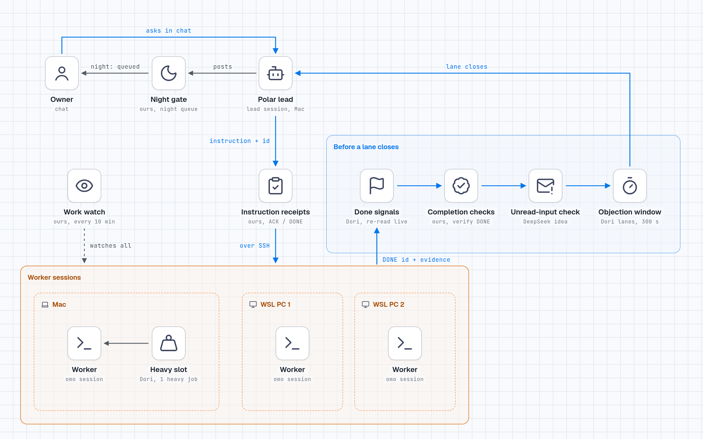

# polar-not-superagent

Polar's fork of [sisyphuslabs/dori-superagent](https://github.com/sisyphuslabs/dori-superagent): not a new superagent, but a record of how one working agent harness uses Dori.

The upstream README is kept unchanged as [UPSTREAM-README.md](UPSTREAM-README.md), and the translated READMEs (German, Italian, Japanese, Chinese) are upstream's own. The code in this repository is upstream's code at 0691374. This page, [SETUP.md](SETUP.md), the setup scripts in [polar/](polar/), the pages in [docs/polar/](docs/polar/), the examples in [examples/polar/](examples/polar/) and the picture below are the only things we added.

## Set up your own Polar

Paste this one line into an OmO session:

```text
Read https://raw.githubusercontent.com/ashmoonori-afk/polar-not-superagent/main/SETUP.md and set yourself up exactly as it says, step by step, asking me only where it tells you to.
```

[SETUP.md](SETUP.md) walks the agent through it: ask who you are (name, how to address you, chat language, time zone, GitHub account) and keep that in a local profile, explain what Polar is, what it can take on and how it brings in new technology from GitHub, then install agent-messenger and ask which platform to use, log in, create the bot, name itself and pick an avatar, greet you, take every request through a monitor, connect calendars and accounts through zele, onboard itself, and keep the session alive across reboots.

### Set up from the Claude or ChatGPT app

If you use the Claude or ChatGPT desktop app, paste this sentence into it (in the Claude app, use the Code tab, which can run commands on your computer):

```text
Read https://raw.githubusercontent.com/ashmoonori-afk/polar-not-superagent/main/docs/polar/app-setup.md and follow it step by step to set up Polar on this computer for me.
```

The app installs what Polar needs, starts Polar in a hidden terminal and passes Polar's questions to you in the app chat until Polar's messenger bot greets you. From then on you talk to Polar in the messenger. Details: [docs/polar/app-setup.md](docs/polar/app-setup.md).

If you only use a chat in the browser, it cannot run anything on your computer. Paste this line into Terminal once, then answer Polar's questions with `tmux attach -t polar` (leave with Ctrl-b, then d):

```bash
curl -fsSL https://raw.githubusercontent.com/ashmoonori-afk/polar-not-superagent/main/polar/bootstrap.sh | bash
```

Model roles, per-model context compaction, how omo builds each model's prompt, and the token-saving rules: [docs/polar/models-and-context.md](docs/polar/models-and-context.md).

## What Polar is

Polar is {user}'s orchestrator agent, where {user} is whoever sets it up: one long-running lead session talks to {user} in a messenger and hands work to worker sessions on the same machine or on other machines reached over SSH. It runs on [omo](https://github.com/code-yeongyu/oh-my-openagent). SETUP.md asks {user} for their name, language, time zone and GitHub account and keeps them in a local profile, so nothing about a particular person comes from this repository.

The tables below describe the reference setup this fork was written from: one lead session on a Mac, with worker sessions on the Mac and two Windows PCs running WSL. That setup's code lives in a private workspace; this page describes it and does not ship it.

## Where each piece acts



Each check sits on the step it guards. The night gate sits on posts to {user}. Instruction receipts sit on the way out to workers. Four checks run before a lane closes. The heavy slot sits on the 8 GB Mac. Blue lines are the work path; the dashed line is the work watch.

## Taken from Dori, and how we changed it

These parts came from Dori revisions published under MIT (Copyright (c) 2026 YeonGyu Kim), before upstream moved to the Sustainable Use License on 2026-11-08. Each port keeps the upstream LICENSE next to it.

| Piece | Where it came from | What it does in Polar | What we changed, and why |
|---|---|---|---|
| Dori mode bundle (items 1-5) | `omo-dori-mode-experimental` at 742f09d, installed 2026-10-07 next to the existing agent; nothing upstream was overwritten | An installable CLI and config with tests; per-lane JSON state with history and live sync; a resource-aware launch queue with heavy slots; one send/edit path across chat platforms | We kept our own pieces where we already had them: a Korean chat voice instead of Dori's style, status relays from remote machines over SSH, our scheduler and watchdogs, and tmux as the backend, with herdr only as a view. |
| Objection window and lane close | Same bundle | A lane closes only after a 300-second objection window and a live check of its Done condition. It refuses to close with dirty or unpushed work. | Every close path is guarded, because upstream's direct close skipped the objection window. Untracked files and the lane's own working directory now count as dirty. |
| Resource checks in the launch queue | Same bundle | Decides whether a machine has room for another session | Memory on Linux and WSL is sampled for real, and a missing measurement fails closed. On WSL we check the Windows disk behind the guest, because the guest disk is thin-provisioned: it reported about 951 GiB free while Windows had about 41 GiB. |
| Done signals | dori-mode `scripts/src/signals.ts`, ported 2026-11-02 | Every task carries a Done condition written at launch in the Dori grammar (merged, closed, published, command, file, url), and a watcher re-reads it live. | Our earlier checker parsed evidence out of prose and rejected 818 of 834 claims. Changes: paths and working directories must be absolute; command, file and url checks run on the task's own machine; each option may appear once; a line holds at most one command. |
| Heavy slot | dori-superagent `heavy-slot.ts` | One heavy job at a time on the 8 GB Mac, and only while it has room | The memory check is ours. Nested calls inside a slot run directly, so a build cannot wait on itself. |

## Ideas from DeepSeek's prototype

From [dsh-superagent-prototype](https://github.com/deepseek-ai/dsh-superagent-prototype) we took one idea, not code. The code is our own.

| Piece | What it does | Why it exists |
|---|---|---|
| Unread-input check | A delivered message counts as admitted, not read. The session's own transcript decides. If a worker writes DONE while an instruction sent before it never reached its transcript, an alert fires and the closer refuses to close that session. | It happened: a worker wrote DONE while another delivery to it was still held. |

## Our own additions

These parts are ours and run around the Dori loop.

| Piece | What it does |
|---|---|
| Instruction receipts | Every instruction gets an id (`J-YYMMDD-NNN`). The worker writes `ACK id` when it starts, then either `DONE id` with evidence or `BLOCKED id: reason` when it ends. No ACK within 10 minutes raises an alert, and a BLOCKED goes to a person. |
| Completion checks | Every DONE is verified on its own. File paths must exist. A PR must be merged, or open with every check green when the claim says "opened". A commit must be reachable from the remote default branch. A deployed file must read back exactly. Claims that cannot be verified are rejected with a reason and retried on a schedule, six attempts over about 31 hours. A claim that carries a Done line is judged by that line alone: the older evidence parser treated every path it found as a git repository and rejected every such claim. |
| Delivery into a running session | Messages go through the session's own control socket as a real user turn. When the session is idle the message starts a turn; when it is busy the message queues behind the running turn. A terminal fallback exists. Held sessions are refused rather than typed into. |
| Work watch | Every 10 minutes in the daytime it looks for trouble: a worker's tmux session that disappeared; a session that is paused or gets no model reply; a PR that is green and mergeable but untouched for 3 hours, too big, or too old; a remote session that needs a model switch. |
| Close-finished | Finished worker sessions are closed automatically, but never while an instruction is unread or its state is unknown. |
| Night gate | Routine posts to {user} between 22:00 and 07:30 KST wait in a queue for the morning. Only a direct reply or a real outage goes through. |
| Promise ledger | Every "I will do X at T" the agent says to {user} is recorded. At T it fires, and it keeps firing until it is closed with evidence. |
| Login self-heal | Every subscription login is checked every 5 minutes and whenever the credential pool changes. A login counts as lapsed when its account check fails or when every account in the pool is blocked. The provider's own login flow then runs in an agent child process, and its sign-in link opens in the browser where {user} is already signed in. Some consent pages keep the approve button disabled behind an invisible bot check; the watcher first moves real pointer input over the page, and as a fallback opens the link in the plain browser, without the automation debugger attached, for one OS-level click. The provider's callback finishes the login and an auth check confirms it. Nobody is asked to log in. |
| Session reload after a re-login | A running session keeps the account slot it picked at start. After a re-login, idle sessions that sit on a removed slot or on a fallback model are reloaded one at a time, never in the middle of a turn, and each gets one probe message to prove it answers. |
| Idle-session cleanup | Every two hours, agent sessions that are idle, not protected, and have printed nothing for three hours are closed. A ledger entry is written before each close, and the lead gets one line when anything was closed. |
| Worker reports through the lead | Workers write tagged lines (POST, NEED, BLOCKED, RESULT, DONE) to a status file, and a relay reads them every minute. In lead mode the relay stores each report in an inbox for the lead instead of posting it to {user}: progress wakes the lead at most once per 30 minutes per worker, results at once, and a blocker only after its inbox write succeeded. Files a report names are copied with a size cap. Lead mode stays off until the lead's monitor filter passes the new wake lines, so no report is lost while switching, and lines already in a file when a new tag appeared are not replayed. |
| Error-stop detection | A worker whose last turn ended in a model error, with no good reply after it, is reported as stopped after a five-minute grace, even when its thread looks fresh. Login and provider outages show up within one watch cycle instead of after the silence timeout. |

## Keeping up with upstream

- Synced to upstream `main` at 0691374 on 2026-11-09. Apart from this README, SETUP.md, `polar/`, `docs/polar/`, `examples/polar/`, the picture and the renamed upstream README, `main` is upstream's tree.
- Since 2026-11-05 we read new upstream commits every evening and compare the useful ones with the tables above.
- We have not contributed anything to the upstream repository yet.

## License

Upstream's license applies and is kept unchanged in [LICENSE](LICENSE). Upstream changed it from MIT to the Sustainable Use License on 2026-11-08 (upstream #160); upstream says revisions published before then stay MIT. The picture was made with stack-diagram, using icons from Lucide.
