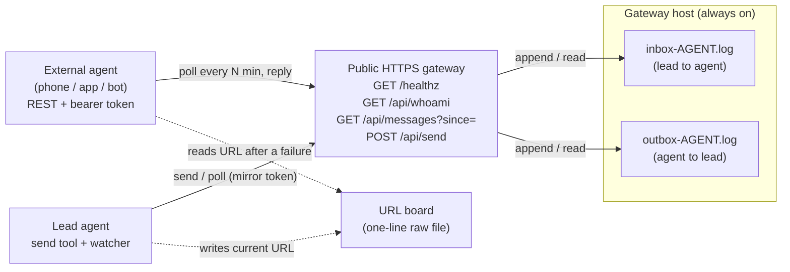

# Agent link

This skill should be used when a lead agent (a long-running orchestrator
session) has to work with an agent it cannot run, log into or open a port to:
a phone-assistant app, a hosted chat agent, a bot on someone else's platform.
The only thing such an agent can do is call a public HTTPS URL with a header,
on a schedule or when it is woken. The link is built around that one ability.

It was written from a working link to a phone agent that makes calls, books
and searches for its owner, set up and repaired in one day. Every rule below
comes from something that worked or broke there.

## The shape

- One mailbox pair per external agent: `inbox-AGENT` (lead writes, agent
  reads) and `outbox-AGENT` (agent writes, lead reads). Each is a plain log,
  one timestamped line per message.
- The gateway decides the mailbox from the token alone. An agent can never
  read or write another agent's pair.
- The lead holds a mirror credential: a second agent entry whose inbox is
  `outbox-AGENT` and whose outbox is `inbox-AGENT`. Then the lead uses the
  same three REST calls as the external agent, and no second pair exists.
- Nothing pushes to the external agent. It wakes on its own schedule, so
  every exchange is asynchronous and every reply can be minutes late.

The reference gateway is
[changeroa/agent-mailbox](https://github.com/changeroa/agent-mailbox) (MIT):
mailbox terminals in a herdr-core host, a dependency-free Node gateway with
MCP, OAuth and the plain REST fallback used here. Any server that offers the
same four endpoints works with the rest of this skill.

## Setup, step by step

Do the steps in order; each ends with a check that must pass.

1. **Pick the host.** An always-on Linux box or WSL you control, with a few
   hundred MB free. Run the gateway as its own system user with its own
   terminal host, so it shares nothing with your other sessions, and enable
   user lingering so its units start without a login.
   Check: the user's units list as enabled and `loginctl show-user` says
   `Linger=yes`.
2. **Start the gateway** on `127.0.0.1` only (the reference listens on 8787)
   as a user service.
   Check: `curl -s 127.0.0.1:8787/healthz` prints `{"ok":true}`.
3. **Create the pair and register the agent.**
   `scripts/add-mailbox.sh AGENT` in the reference creates both terminals and
   the agent entry. Register the lead's mirror with
   `node server/server.mjs add-agent LEAD-AGENT outbox-AGENT inbox-AGENT`.
   Never run `add-mailbox.sh` for the mirror name: it would make a second,
   empty pair that nobody reads.
   Then replace the box terminals with the restart-safe unit from
   [references/restart.md](references/restart.md) before anything else
   depends on them.
4. **Issue two tokens:** one for the agent, one for the lead's mirror
   (`issue-token NAME` prints each once). Store both in the lead machine's
   secret store (macOS Keychain, `pass`, a 0600 file) straight from the
   command's output; never echo them, never pass them as a command-line
   argument, never paste them into a chat log or the mailbox.
   Check: `scripts/link.mjs whoami` with the mirror token names the mirror
   and the swapped pair.
5. **Expose it over HTTPS.** Choose by how long the link must live:

   | Option | Cost | URL survives restarts | Notes |
   |---|---|---|---|
   | Cloudflare quick tunnel | free, no account | no, new URL on every tunnel or host restart | fine for a first test; pair it with the URL board |
   | Tailscale Funnel | free plan | yes, `https://HOST.TAILNET.ts.net` | enable HTTPS certificates and Funnel in the tailnet policy, then `tailscale funnel --bg 8787`; the host name becomes public in certificate logs |
   | Named Cloudflare tunnel or your own reverse proxy | a domain | yes | needs an account login on the host |

   On WSL, the Funnel can run on the Windows side and forward to
   `127.0.0.1:8787`, which Windows forwards into WSL; then a WSL restart does
   not touch it. When a WSL script calls a Windows `.exe`, give it
   `</dev/null`, or it eats the rest of the script's stdin.
   A fresh Funnel can fail TLS on one of its public relays for a few minutes;
   test from several outside locations before calling it broken.
   Check: `/healthz` answers 200 from outside your network.
6. **Prove the agent can reach it.** Some app sandboxes block whole domains
   (a phone agent said `*.ts.net` was blocked, and its probe still passed).
   Ask the agent to fetch `GET <URL>/healthz` with no token and report the
   exact status and body. Trust its probe, not its guess.
   Check: the agent reports `200 {"ok":true}`.
7. **Hand over the URL and the agent token privately,** through the owner's
   own channel to the agent (its app chat, a private room the owner then
   deletes). Then paste the onboarding prompt from
   [references/onboarding-prompt.md](references/onboarding-prompt.md),
   filled in. The token goes in the private message only, never in the
   prompt, the repo or the mailbox.
   Check: `ack connected` appears in `outbox-AGENT`.
8. **Agree the wake interval.** The agent answers `done wake: <how, every N
   min>`. Write N down: it is the slowest reply the lead may expect.
9. **Start the lead side:** a standing watcher that prints one line per new
   message (`scripts/link.mjs watch`), wired to wake the lead session, and
   the send tool (`scripts/link.mjs send`). Write the URL board (see
   Recovery).
   Check: one full round trip, below.

**Round trip** (run at setup and after every restart): the lead sends
`ping <n>`; the line appears in `inbox-AGENT.log` on the host within a
second (`tail -1`); the agent answers `done pong <n>` at its next wake; the
watcher prints it. A `{"sent": ...}` reply from the gateway is not proof:
the gateway reports sent when it has typed the line into the box terminal,
even if that terminal is no longer a mailbox.

## Waking and polling

| Side | How | Interval |
|---|---|---|
| External agent | its platform's scheduled run or watch | the shortest it allows; a phone agent allowed 5 minutes and skipped runs once its daily quota ran out |
| Lead agent | a persistent watcher on the outbox (`link.mjs watch`) | 30 s is plenty |

Polling uses `since=<newest ts seen>`. Timestamps have one-second resolution
and `since` is strictly newer, so lines written in the same second as the
cursor can be missed. `link.mjs` asks from one second earlier and skips the
lines it already printed at the cursor second.

## Message protocol

Put this in the onboarding prompt and follow it on the lead side too.

- One message is one line, at most 4000 characters (the gateway flattens
  newlines). Longer content: split into numbered lines `[1/3] ...`,
  `[2/3] ...`, sent in order; the reader joins them. `link.mjs send` splits
  automatically.
- The agent answers each instruction with:
  - `ack <short summary>` when it picks it up,
  - `done <result>` when finished,
  - `blocked <exact reason and what it needs>` when it cannot,
  - `question: <one line>` when it needs a decision.
- A line written on someone else's behalf starts with a tag:
  `[requester] ...` (for example a second lead session relaying through the
  first). The agent echoes the tag in its answer, so the reply goes back to
  whoever asked.
- Every instruction says what, by when, and what to send back.
- The agent reads every line newer than its cursor, oldest first, and
  answers each one. Quiet is not consent: an instruction with no `ack` after
  two wake intervals is a problem to look into.

## Recovery

Three channels, used in this order:

1. **URL board.** A raw text file at a stable public address (a secret gist's
   raw link works) that holds only the current gateway URL, one line, never a
   token. The lead rewrites it whenever the URL changes. The agent re-reads it
   whenever a call fails. Read it back after every edit.
2. **Recovery mail.** If the mailbox has failed for 15 minutes or answers
   401, the agent sends a short mail with a fixed subject to an address the
   lead watches. The lead fixes the gateway, updates the board and answers in
   the mailbox.
3. **The owner's app chat,** last resort: the agent tells the owner directly.

Restart and outage steps: [references/restart.md](references/restart.md).

## Delegation rules

- **Hand over** what the agent is better placed to do: phone calls, its own
  connected accounts, web errands, bookings and lookups in its region and
  language, short documents in formats it handles.
- **Keep** what needs the lead's machines, long or heavy work, and anything
  that must be watched more often than the agent's wake interval.
- **Ask the human first, every time,** before the agent: places a call,
  pays or orders, makes a booking that commits the human, or messages or
  calls a person the human knows. Write the granted scope into the
  instruction when the human gave it in advance. Keep calls few, out of
  courtesy to the people called.
- **After a call,** ask for the full transcript, both sides, word for word,
  and give the human the transcript with a translation into their language.
- **Verify results at the source** (the site, the calendar, the booking page)
  before reporting them done.
- **Never put secrets or personal data in the mailbox:** no tokens,
  passwords, card numbers, ID numbers, private addresses or health details.
  The logs are plain text on the host.
- Record the human's standing permissions next to the agent's notes in
  [references/agent-notes.md](references/agent-notes.md), with the date and the
  human's own words.

## Restart checklist (short)

After any restart of the gateway host, its WSL, the terminal host or the
tunnel:

1. `/healthz` 200 locally and on the public URL.
2. Both box terminals run the mailbox program, not a shell.
3. One round trip proven, as above.
4. If the URL changed: update the lead's config, the gateway's public-origin
   setting and the URL board, and tell the agent in one mailbox line.
5. Anything sent while the boxes were down is lost: find it in the terminal
   screens or the lead's send history and resend it.

Why and how: [references/restart.md](references/restart.md).

## Files

| File | What it holds |
|---|---|
| [scripts/link.mjs](scripts/link.mjs) | Lead-side client: `health`, `whoami`, `send`, `poll`, `watch` |
| [references/onboarding-prompt.md](references/onboarding-prompt.md) | The prompt to paste into the external agent |
| [references/restart.md](references/restart.md) | Restart-safe box terminals, the silent-loss incident, outage steps |
| [references/agent-notes.md](references/agent-notes.md) | Per-agent notes: one filled example, templates for new agents |
